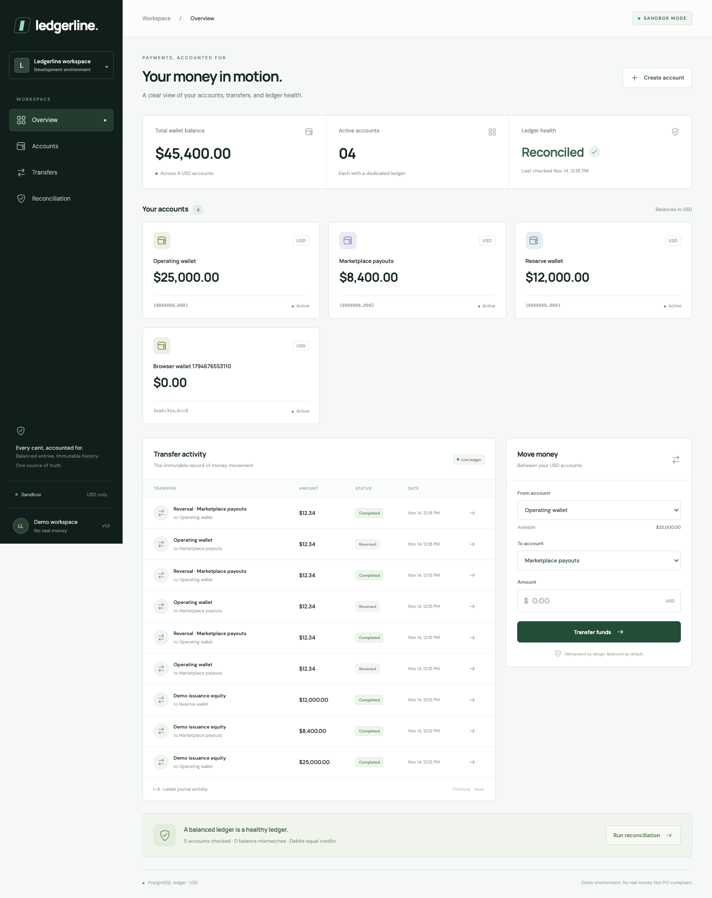

# Ledgerline

**Payments, accounted for.** A small payments core built with TypeScript, Fastify, PostgreSQL, React, and Vitest. Transfers are idempotent, journals are balanced at commit, and balances can be rebuilt from immutable entries.

**Demo software. No real money. Not PCI compliant. USD only.** No authentication or authorization: run locally, never expose this server to the public internet.



## Run it

Requires **Node.js 22.12+**, npm, and Docker (or an existing PostgreSQL 17 instance).

```sh
git clone https://github.com/chsktg1/ledgerline.git
cd ledgerline
npm ci
cp .env.example .env
docker compose up -d --wait
npm run db:migrate
npm run db:seed
npm run dev
```

Open **http://127.0.0.1:5173**. The development proxy sends `/api` to Fastify on port 3000. Seed creates three wallets and funds them through balanced journals against a system equity account. Re-running seed does not issue money again. New accounts start at zero; transfer demo funds into them.

For the built dashboard served by Fastify:

```sh
npm run build
npm start
# http://127.0.0.1:3000
```

With an existing Postgres instance, create databases `ledgerline` and `ledgerline_test` and set both connection URLs in `.env`. Docker's test database is created only when its data volume is first initialized. On an existing volume, create it manually if needed:

```sh
docker compose exec postgres createdb -U ledgerline ledgerline_test
```

## The three proofs — actual output

Captured locally on **November 14, 2026**, against **real PostgreSQL 17**, using the API request pipeline and a connection pool of 20. These are finite integration checks, not a throughput benchmark or an exhaustive formal proof. No in-memory database, mocked transaction, or fabricated result.

```sh
npm run test:proof
```

```text
PROOF 1 PASS | 100 concurrent requests | 50 completed | 50 rejected | sender=0 | receiver=10000 | no lost updates
PROOF 2 PASS | 10 same-key requests | 1 transfer | 2 entries | 750 minor units moved exactly once
PROOF 3 PASS | 6 consistent snapshots | debits=14000 | credits=14000 | 3 rebuilt balances match | 0 mismatches
```

All amounts above are integer **minor units (cents)**. The first proof starts with 10,000 cents and sends 100 simultaneous requests for 200 cents each. The third includes the initial 10,000-cent issuance and 4,000 cents of wallet transfers in both journal totals.

**16 integration tests passed.** [Full captured test output](docs/proof-output.txt). Additional coverage includes payload conflicts, repeated overdraft rejection, simultaneous reversal attempts, failed reversal retries, opposite-direction transfers, deliberate balance corruption, invalid journal rollback, audit immutability, input validation, account creation, and preventing API issuance from system equity.

The initial suite caught a decimal-input validation bug (500 instead of 400); it was fixed and the full suite rerun before this capture. If a future run fails, its failing assertion is the result; the capture is a dated record, not a live guarantee.

**Tests truncate their database.** `TEST_DATABASE_URL` is required and its database name must end in `_test`; it never falls back to the development database. The suffix is a guardrail, so still check the URL before running.

```sh
npm run build       # strict TypeScript check + production React build
npm test            # all real-Postgres integration tests
npm run format:check
npm audit           # dependency advisory check; zero known vulnerabilities at capture
```

A browser smoke check also exercised a payment, two audit entries, reversal, reconciliation report, account creation, and a 390px mobile viewport with no page errors. To repeat it, start the seeded app on port 3000 and have Google Chrome installed:

```sh
npm run test:browser
```

This browser check writes real local demo audit records and creates a zero-balance wallet; it does not delete its history. [Mobile screenshot](docs/mobile.png).

## Architecture

```text
React dashboard
  accounts / transfer form / audit details / reconciliation reports
                    │ same-origin JSON /api
                    ▼
Fastify + Zod
  strict request validation, string minor units, required idempotency key
                    │
                    ▼
PostgreSQL transaction (READ COMMITTED)
  1. Lock idempotency key using transaction-scoped advisory lock
  2. Return existing result, or reject a conflicting request hash
  3. For reversal: lock original transfer and check existing reversal
  4. Lock both accounts FOR UPDATE, in UUID order
  5. Check available balance; insert completed or rejected transfer
  6. Completed only: insert debit and credit
       └─ insert trigger updates the cached account balances
  7. Deferred constraint triggers validate the complete journal
  8. COMMIT, then respond
                    │
                    ▼
Immutable transfers + entries       Cached account balances
                    │                         │
                    └────────────┬────────────┘
                                 ▼
Reconciliation: REPEATABLE READ snapshot
  recompute each balance, compare cache, sum debits and credits,
  persist immutable report (including every compared balance)
```

### Accounting and money representation

Wallet balances represent liabilities to wallet holders: a **debit decreases** a wallet balance; a **credit increases** it. Every completed transfer has exactly two equal entries, one for the sender and one for the receiver. Rejected transfers have zero entries. The schema checks amounts, currencies, directions, account IDs, and the transfer's declared amount at commit. A single-sided or incorrectly assigned journal rolls back, including the cached balance updates.

The journal is the source of truth. `accounts.balance` is a transactional cache maintained by the entry-insert trigger; payment code never issues independent balance updates. Reconciliation detects cache corruption and reports it rather than silently rewriting history.

API amounts are positive integer strings in cents, capped at `9007199254740991` per transfer. Postgres stores balances as `bigint`, journal sums use `numeric`, application comparisons use `BigInt`, and the dashboard formats cents using `BigInt` without floating-point conversion. Only USD is accepted. There is no foreign exchange or multi-currency journal.

The seed's system equity account is the offset for simulated money issuance and can be negative. Customer wallets cannot be negative. Equity is excluded from the wallet list and is not accessible as an API transfer account. It remains visible in issuance journal detail and reconciliation, where total balances across wallets **and equity** are zero.

### Concurrency choice and trade-off

`SELECT … ORDER BY id FOR UPDATE` locks both affected accounts before checking funds. Competing debits see the previous committed result before deciding whether to proceed. Locking in a consistent order also avoids opposite-direction payment deadlocks. Database checks reject negative wallet balances independently.

This keeps the consistency model small and explicit. Transfers involving the same popular account serialize, and locks occupy pool connections until commit. This design favors correctness over hot-account throughput. No claimed production scale, distributed locks, or application-side read/modify/write balance arithmetic.

### Idempotency semantics

Keys are globally scoped for this single-workspace demo, case-sensitive, and 1–128 printable non-space ASCII characters. The normalized request (lowercase UUIDs, canonical integer string, USD) is hashed with SHA-256. Reversal requests hash their original transfer ID and share the same key namespace with payments.

A transaction-scoped advisory lock on the key serializes simultaneous retries, and a unique database constraint is the final duplicate guard. A rare advisory-hash collision only serializes unrelated keys; the full stored key and request hash still determine identity.

- Same key + same normalized payload: original immutable transfer, with `replayed: true` and `Idempotency-Replayed: true`.
- Same key + changed payload or operation: `409 IDEMPOTENCY_CONFLICT`.
- Insufficient funds: persisted `rejected` transfer, HTTP 422, zero journal entries. Retrying the key returns that rejection even if funds later arrive. Use a new key for a new payment intent.
- Invalid inputs, unknown accounts, and disallowed operations: validation/error responses without a transfer record or a consumed key.
- Connection loss before a response: retry the same key. A pre-commit crash rolls back; a post-commit retry returns the committed record. Records and keys do not expire.

The browser retains a key for an uncertain request while the page is open. A confirmed rejected request permits a new intent on the next submission. Browser reloads do not preserve pending keys; external API clients must persist their keys themselves.

### Reversals and audit history

`POST /api/transfers/:id/reverse` creates a new transfer with opposite entries and `reverse_of` pointing to the original. The original row and its entries are never edited. Audit reads compute `reversal_id` from the linked completed reversal; the dashboard labels that original as **Reversed** while its stored execution status remains **completed**.

A unique partial index permits only one **completed** reversal per original. Failed attempts stay linked and visible, without consuming that completed reversal slot. Reversal requires funds in the original receiver's wallet; it can be rejected for insufficient funds. A new key may be used after funds return. Reversing a reversal, a rejected transfer, or seed issuance is not supported.

Entry, transfer, and reconciliation report updates/deletes are blocked by triggers. There is no delete endpoint. This is application audit immutability, not tamper-proof storage against a database owner who can disable triggers or truncate tables.

### Reconciliation consistency

The job runs all balance comparisons and journal totals inside one **REPEATABLE READ** transaction. A payment committing halfway through the run cannot appear in only one of its queries. Reports preserve totals, every compared balance (including equity), mismatches, timestamps, and pass/fail flags. They represent a point-in-time snapshot, not a continuously updated assertion. Trigger manually from the UI or API.

## API examples

```sh
# Zero-balance wallet
curl -s http://127.0.0.1:3000/api/accounts \
  -H 'Content-Type: application/json' \
  -d '{"name":"Customer payouts","currency":"USD"}'

# Seeded wallets, balance amounts in cents
curl -s http://127.0.0.1:3000/api/accounts
curl -s http://127.0.0.1:3000/api/accounts/10000000-0000-4000-8000-000000000001

# Transfer $12.50; repeat this exact request to get the original result
curl -i http://127.0.0.1:3000/api/transfers \
  -H 'Content-Type: application/json' \
  -H 'Idempotency-Key: example-payment-001' \
  -d '{"senderId":"10000000-0000-4000-8000-000000000001","receiverId":"10000000-0000-4000-8000-000000000002","amount":"1250","currency":"USD"}'

# Replace TRANSFER_ID with the returned transfer.id
curl -s http://127.0.0.1:3000/api/transfers/TRANSFER_ID
curl -i -X POST http://127.0.0.1:3000/api/transfers/TRANSFER_ID/reverse \
  -H 'Idempotency-Key: example-reversal-001'

# New snapshot, then recent reports
curl -s -X POST http://127.0.0.1:3000/api/reconciliation
curl -s http://127.0.0.1:3000/api/reconciliation
```

| Endpoint                               | Behavior                                                                       |
| -------------------------------------- | ------------------------------------------------------------------------------ |
| `GET /api/health`                      | Database connectivity                                                          |
| `POST /api/accounts`                   | Create a zero-balance USD wallet                                               |
| `GET /api/accounts`                    | Wallet list with cached balances                                               |
| `GET /api/accounts/:id`                | Single wallet balance                                                          |
| `POST /api/transfers`                  | Required `Idempotency-Key`; 201 new, 200 replay, 422 insufficient funds        |
| `GET /api/transfers?limit=50&offset=0` | Transfer history, including rejected transfers and reversals; max 100 per page |
| `GET /api/transfers/:id`               | Transfer, entries, key, status, timestamps, reversal links                     |
| `POST /api/transfers/:id/reverse`      | Required `Idempotency-Key`; new balanced reversal                              |
| `POST /api/reconciliation`             | Persist a new consistent report                                                |
| `GET /api/reconciliation`              | Latest 50 reports with full comparisons                                        |

Request bodies are strictly validated; extra payment/account fields are rejected. Error shapes are `{ "error": "CODE", "message": "..." }`, except persisted insufficient-funds outcomes, which return `{ "transfer": { ... }, "replayed": false }` with HTTP 422. Idempotent replays of rejected transfers retain HTTP 422. No headers or monetary strings are silently rounded.

## Scope and honest limitations

- This is a local portfolio payments core, not a bank, processor, or production service. No real deposits, external settlement, card data, or PCI compliance.
- One workspace and one currency (USD). No auth, tenants, ownership checks, rate limits, quotas, or request signing. Bind is loopback by default; no public deployment is included.
- Optional holds/capture/release are **not implemented**. Available balance equals the wallet's posted balance.
- No webhooks, outbox, fees, interest, refunds to external rails, or background reconciliation scheduler. Reconciliation is manual.
- Database credentials are a development convenience. Production would need separate migration/application roles, least-privilege grants, backups, recovery drills, key retention policy, monitoring, and operational controls.
- Audit triggers do not protect against database administrators. Cache tampering is detectable, not prevented for an owner connection.
- Balances can overflow Postgres `bigint` after sufficiently large cumulative activity; that transaction fails atomically. Transfers have a smaller per-request cap. No automatic deadlock/serialization retry policy or request timeout policy is provided.
- Offset pagination can shift during concurrent inserts; history is not a stable exported snapshot. Lists are manually refreshed through navigation and actions, not a realtime subscription.
- Reports contain all accounts in one JSON snapshot; this and synchronous reconciliation are suitable for this small demo, not an unbounded ledger.
- Browser idempotency intent is kept in memory, not across reloads. Browser fonts load from Google Fonts with local fallbacks. The browser smoke script requires installed Chrome and is separate from CI's database proofs.

## Repository map

```text
src/app.ts                 HTTP routes and validation
src/ledger.ts              transactions, idempotency, locking, reversals, reconciliation
src/db.ts                  shared PostgreSQL connection pool
db/001-ledger.sql          tables, indexes, balance and invariant triggers
scripts/migrate.ts         transactional, advisory-locked migration runner
scripts/seed.ts            repeatable balanced demo issuance
scripts/browser-smoke.ts   real browser workflow and screenshots
web/src/                   React dashboard and responsive styles
tests/ledger.test.ts       16 real-database integration tests
.github/workflows/ci.yml   PostgreSQL service, build, and proof suite
docs/                      captured test output and actual UI screenshots
```
